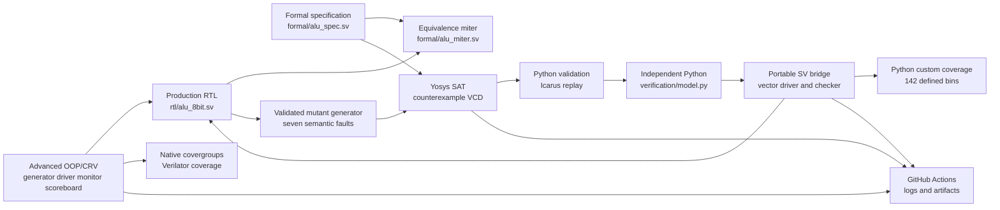

# RTL Verification Core ALU

**Independent digital hardware verification engineering project**

This repository implements an unsigned combinational 8-bit ALU with eight
operations and a 16-bit result. The engineering focus is not the size of the
RTL; it is the design of independent, failure-propagating verification layers
that can distinguish correct behavior from an incomplete test, a faulty DUT, or
a broken verification tool.

## What is implemented

The DUT accepts unsigned `A[7:0]`, `B[7:0]`, and `opcode[2:0]`, and produces
`result[15:0]`. The eight operations are:

| Opcode | Operation | Defined behavior |
|---|---|---|
| `000` | ADD | 16-bit sum, including carry |
| `001` | SUB | Unsigned subtraction modulo 65536 |
| `010` | MUL | Full 8 x 8 product |
| `011` | DIV | Floor division; zero when `B == 0` |
| `100` | AND | Zero-extended bitwise AND |
| `101` | OR | Zero-extended bitwise OR |
| `110` | XOR | Zero-extended bitwise XOR |
| `111` | SHL | `A` shifted by `B[2:0]`, with a 16-bit result |

The complete behavioral contract is documented in
[ALU_SPECIFICATION.md](docs/ALU_SPECIFICATION.md).

## Key measured results

These results come from separate local experiments and GitHub Actions
artifacts; they are not one combined test count.

| Measurement | Result |
|---|---:|
| Known-binary input combinations exhaustively simulated | 524,288; 0 failures |
| Python custom functional coverage | 142/142 bins |
| Advanced OOP/CRV transactions | 4,096 |
| Native SystemVerilog covergroup coverage | 80/80 bins (100%) |
| Formal-derived semantic mutants | 7/7 killed |
| Independently validated formal counterexamples | 7/7 |
| Phase 3 adversarial infrastructure tests | 42 Python tests, including 26 formal-mutation tests |

The 142-bin Python plan and the native SystemVerilog covergroup are different
metrics. Exhaustive simulation is also distinct from a SAT proof.

## Verification architecture



Verification layers have different purposes:

1. The Python reference model supplies an independently written expected result.
2. Directed, seeded-random, metamorphic, and exhaustive simulation exercise the
   portable checker and the DUT.
3. Custom functional coverage measures selected reachable scenarios; it is not
   code coverage.
4. The advanced SystemVerilog environment tests class-based generator, driver,
   monitor, scoreboard, mailbox synchronization, constraints, and native
   covergroups. It is an educational OOP environment, not UVM.
5. The formal miter compares all 16 result bits over the two-state known-binary
   input domain.
6. The mutation audit tests whether the formal, Python, and Icarus layers detect
   seven deliberate semantic faults.
7. The adversarial audit tests whether the infrastructure itself can fail closed
   rather than report success for missing or invalid evidence.

## Getting started

The portable flow requires Python 3.10--3.14, GNU Make, and Icarus Verilog.
There are no Python package dependencies. Verilator, Yosys, and Z3 are needed
for additional targets.

```sh
# macOS with Homebrew
brew install icarus-verilog verilator python@3.12

# Ubuntu/Debian
sudo apt-get update
sudo apt-get install -y iverilog verilator yosys make python3
```

Available Make targets:

```sh
make unit
make regression SEED=2026 COUNT=1000
make exhaustive
make coverage SEED=2026 COUNT=1000
make mutation
make formal
make formal-mutation FORMAL_REPEAT=2
make advanced SEED=2026 COUNT=4096
make waveform
make clean
```

`make advanced` specifically expects Verilator 5.052 and Z3 4.8.12, matching
the pinned CI environment. The advanced suite is validated remotely in
GitHub Actions; the development machine used for the local portable evidence
does not provide Yosys, Verilator, or Z3. Generated output is written below
`results/`, which is ignored by Git.

## Evidence

- [Evidence index](docs/EVIDENCE_INDEX.md) maps phase results to exact commits,
  jobs, artifacts, and reproducibility limits.
- [Engineering case study](docs/ENGINEERING_CASE_STUDY.md) explains the
  architecture, decisions, audits, results, and threats to validity.
- [Portfolio description](docs/PORTFOLIO_DESCRIPTION.md) contains reusable CV
  text and interview questions.
- [Measured local results](docs/RESULTS.md) preserve portable execution data.
- [Formal verification notes](docs/FORMAL_VERIFICATION.md) define the proof
  domain and SAT negative control.
- [Formal mutation audit](docs/FORMAL_MUTATION_AUDIT.md) describes the seven
  fault models and independent counterexample validation.
- [Advanced suite](docs/ADVANCED_SUITE.md) describes the OOP/CRV and native
  coverage checks.

The most complete published validation is GitHub Actions
[run #10](https://github.com/Vinh-Duy/RTL-Verification-Core-ALU/actions/runs/41591123907)
for commit `bced75a`. It passed formal, portable, and advanced jobs. Artifact
retention is controlled by GitHub; use the run page's **Artifacts** section to
download the evidence rather than relying on permanent artifact URLs.

## Limitations

- This is a small combinational 8-bit design, not a commercial IP sign-off
  platform.
- Formal equivalence covers the stated two-state known-binary domain. It does
  not establish four-state X/Z semantics.
- Seven selected mutants do not constitute exhaustive mutation coverage.
- Advanced simulator execution was validated in Ubuntu GitHub Actions, not in
  the local portable environment.
- No synthesis, PPA, timing, physical-design, silicon, or industry
  certification results are claimed.
- A correct result can still reflect an incorrect shared specification; literal
  answers, properties, and multiple checking layers reduce but do not eliminate
  that risk.

## Repository map

```text
rtl/                 Production ALU and educational adder
formal/              Specification, miter, proof runner, mutation audit
tb/                  Portable, four-state, vector, and advanced benches
verification/        Python model, stimuli, coverage, and runner
tests/               Unit and failure-propagation tests
scripts/             Advanced runner and evidence exporter
docs/                Specification, reports, case study, and evidence index
.github/workflows/   Formal, portable, and advanced CI jobs
```
